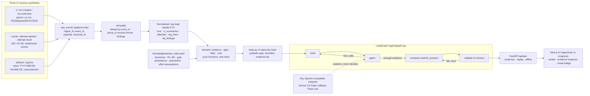

# Technical deep dive

Describes what is in the repository on 16 Nov 2026 (`services/agent-api`). Where a component is planned but not present, it is marked `{{planned}}`. All numbers were produced by running the tools offline on the committed fixtures.

## 1. Architecture

The model has two jobs: choose which tools to call, and write the explanation. Counting, deduplication, normalisation, flake levels, effort arithmetic and the release verdict are Python functions with their own tests. The verdict in the response is copied from `evaluate_release_gate`; the model has no field it can write it into.

Stack as installed in the dev environment: Python 3.12.1 (pyproject requires >=3.11), FastAPI 0.163.1, Pydantic 2.14.3, LangGraph 1.2.22, httpx 0.28.1, PyYAML 6.0.3, psycopg 3.3.9.

## 2. Data lineage: raw to normalised, with provenance

`app/synthetic/generate.py` writes what three real sources would have sent, seeded (`SEED = 20261113`), fixed "now" `2026-11-13T12:00:00Z`. `tests/test_data_quality.py::test_generator_is_deterministic_and_matches_committed_fixtures` regenerates into a temp dir and compares SHA-256 with the committed `services/agent-api/data/synthetic/catalog.json` and `raw_events.jsonl` (the data lives inside the service so the deployed function bundle is self-contained).

`app/etl.py::build` is the only path from raw to normalised, for both the fixture files and the Postgres table (`app/store.py`), so a number computed locally equals the deployed one.

| Step | Code | What is kept |
|---|---|---|
| Deduplicate | `build` step 1: sort by `ingest_id`, first copy wins, later copies recorded | `Attempt.result_ingest_ids` lists every ingest id; `Finding DQ-DUP-*` names them |
| Timestamps | `parse_ts` returns `Stamp(raw, utc, fmt)`; `fmt` is one of `iso-offset`, `iso-z`, `epoch-s`, `epoch-ms`, `naive-assumed-utc`, `missing`, `unparseable` | raw value and UTC side by side; naive strings are an assumption, recorded as finding `DQ-TZ-010` |
| Status words | `norm_status`: `pass/passed/success` → PASS, `fail/failed/failure` → FAIL, else UNKNOWN | `Summary.status_raw` keeps `passed` / `SUCCESS`; finding `DQ-VOC-*` per pipeline |
| Duration | `Attempt.duration_s` returns `None` if either end is missing | never imputed; finding `DQ-MIS-*` |
| No result | `Attempt.status is None` when `attempt.started` has no `attempt.result` | `terminal == False`; finding `DQ-INC-*` (severity critical) |

Formats observed in the dataset (`DQ-FMT-011`): `iso-offset=2671`, `epoch-s=244`, `epoch-ms=114`, `naive-assumed-utc=30`. Totals: 2,053 raw events, 2,051 unique, 120 runs, 892 attempts, 30 log lines, 31 tests, 11 findings.

Every tool returns an `evidence` list of record ids it relied on. `Dataset.record_exists` resolves run ids, attempt ids, CI summary event ids (`ci:run.summary:<run>`), log event ids (`artifacts:log.line:<attempt>:<n>`), finding ids, test ids, the policy id and release-candidate ids. `GET /api/records/{id}` opens any of them.

## 3. Anomaly catalogue

| Anomaly | Records | Finding | Effect in the tools |
|---|---|---|---|
| Duplicate ingestion (webhook redelivery, 7 min later) | `runner:attempt.result:att-chk-main-0403-T-CHK-011-1` (ingest 725, 730); `runner:attempt.result:att-chk-e2e-0075-T-CHK-011-1` (1475, 1488) | `DQ-DUP-001`, `DQ-DUP-002` | counted once; T-CHK-011 has 7 infra retry-passes from 9 raw result events |
| Incomplete gating attempt | `att-pay-main-0233-T-PAY-004-2` (started 09:51:06Z, no result) | `DQ-INC-005` | `rc-pay-2.14.0` → HOLD_MANUAL_REVIEW (R5) |
| Incomplete non-gating attempt | `att-chk-e2e-0070-T-CHK-005-1` | `DQ-INC-003` | excluded from T-CHK-005's rates |
| Missing `finished_at` | `att-chk-main-0418-T-CHK-002-1` (PASS) | `DQ-MIS-004` | duration `None`; appears in Scenario A warnings |
| Missing CI summary | `run-inv-main-0144` | `DQ-SUM-006` | HOLD_MANUAL_REVIEW (R6) |
| Summary contradicts attempts | `ci:run.summary:run-pay-main-0233` PASS (`passed`, emitted 10:02:00Z) vs T-PAY-004 INCOMPLETE | gate check `summary_conflict` | HOLD_MANUAL_REVIEW (R5) |
| Status vocabulary | `pay-main` says `passed`; `sup-main`, `sup-eval` say `SUCCESS` | `DQ-VOC-007..009` | normalised, raw kept |
| Mixed timestamp formats | all sources | `DQ-FMT-011`, `DQ-TZ-010` | UTC plus recorded format |
| Retry resolved by terminal pass | `att-pay-main-0232-T-PAY-004-1` ERROR `ConnectionResetError` → `-2` PASS | — | `rc-pay-2.13.4` → SHIP_WITH_WARNINGS (R2); the twin of Scenario C |
| Infra retries | T-CHK-011, 7 × `SessionProvisioningTimeout` | — | level `infra_only`, not flaky (R1) |
| Proven nondeterminism | T-INV-005, commit `b5e3f16` has final PASS and final FAIL | — | level `proven` (R3) |
| Expired quarantine | T-CHK-011 quarantine expired 2026-11-01; as-of 2026-11-13 | — | test back in the gate, flagged in `quarantine[]` |
| Prompt injection in a log | `artifacts:log.line:att-chk-main-0418-T-CHK-004-2:1` | — | `possible_prompt_injection: true`; warning in the response |
| Active quarantine | T-SUP-003 quarantined until 2026-11-30 | — | excluded from the gate; `eval` suite is non-gating anyway |

## 4. Source-of-truth policy

`catalog.release_policy.source_of_truth`: runner attempt results (final attempt per test) > CI summary webhook (advisory) > artifact logs (context, never decisive). Implemented in `domain/gate.py::evaluate`: the summary is compared against the final attempt of every test outside `ALLOW_FAILURE_SUITES = {"eval"}` (the CI config marks scored LLM evals allow-failure, so the summary never covered them). A summary contradicted by its attempts invalidates the summary, never the attempts. A gating test with no terminal attempt makes the gate unverifiable: HOLD_MANUAL_REVIEW, a different verdict from BLOCK.

The reverse conflict (summary FAIL, every covered test passed) is detected in the same function; the dataset has no such run today.

## 5. The rule file

`knowledge/testops_rules.yaml`, version `2026.11.0`, owner "QA Platform (customer-owned in a pilot)". Served read-only at `GET /api/knowledge`.

- `taxonomy`: error class → category. INFRA (`SessionProvisioningTimeout`, `DeviceAllocationFailed`, `TunnelDisconnected`, `RunnerOOMKilled`, `ArtifactUploadFailed`, `ConcurrencyQuotaExceeded`), EXTERNAL_DEPENDENCY (`ConnectionResetError`, `UpstreamTimeout`, `SandboxUnavailable`), PRODUCT_ASSERTION, TIMING, MODEL_QUALITY, TEST_CODE. Unknown classes map to `UNCLASSIFIED`.
- `rules` R1–R6, each with `title`, `rationale`, `effect`: R1 infra is not flakiness; R2 final status is the last terminal attempt; R3 three levels of flakiness evidence; R4 quarantine is a human act with an expiry; R5 source-of-truth precedence; R6 missing data is reported, never imputed.
- `release_gate.precedence`, first match wins: `unresolved_failure` → BLOCK (R2); `incomplete_gating_test` → HOLD (R5); `summary_conflict` → HOLD (R5); `missing_ci_summary` → HOLD (R6); `retry_pass_in_gating` → SHIP_WITH_WARNINGS (R2); otherwise SHIP.
- `quarantine`: T-SUP-003 (CX AI team, expires 2026-11-30, active), T-CHK-011 (Storefront team, expired 2026-11-01).
- `effort_assumptions`: minutes per investigation 10/20/35, loaded USD per hour 40/60/90.

The gate code reads the precedence list; changing the policy is a YAML edit, and `rules_version` is returned with every verdict.

## 6. The LangGraph loop and why it exists

`app/agent/graph.py::build_graph`: nodes `agent` → (`tools` → `agent`)* → `compose` → `validate` → (`compose` once more) → END.

- `agent`: one chat call with the 8 tool specs, `tool_choice="auto"`, temperature 0.
- `tools`: executes each requested call through `run_tool`; argument errors come back as `{"error": ..., "hint": ...}` so the model can correct itself; `MAX_TOOL_CALLS = 8`; tool payloads over `MAX_TOOL_CHARS = 9000` are truncated with a hint to use `get_record`. Every `evaluate_release_gate` result is stored in `state.gates`.
- `compose`: forces the `submit_answer` function (`tool_choice="required"`) whose schema is `Draft` (answer, recommended next action, 3–6 claims with evidence ids, assumptions, uncertainty). The computed verdicts are appended to the instruction so the model states them exactly. If the model answers in prose, the prose is kept and the validator flags it.
- `validate`: deterministic (section 7). On failure the problems are fed back and `compose` runs once more (`revisions <= 1`); after that the response ships with `validation.passed = false` and the flagged claims marked `supported: false`.

Why a graph rather than a single tool-calling call: two loops a single prompt cannot give. The model may keep fetching evidence until it has enough (Scenario A took 4 calls, Scenario C 3, measured during development), and a deterministic checker can send the draft back with the exact defects. A straight line would be decoration; the graph is here for those two edges. Mapping to Observe–Orient–Decide–Act: tools observe, the rule file orients, `gate.evaluate` decides, the human acts.

## 7. Validator checks

`app/agent/validator.py::validate(answer, claims, tool_results, ds, gate_verdicts)`:

1. `evidence_ids_resolve`: every cited id exists in the dataset (`record_exists`); unknown ids mark the claim `supported: false`.
2. `evidence_retrieved_this_request`: every cited id was returned in some tool's `evidence` list in this request (no citing from memory).
3. `claims_have_evidence`: no claim without ids.
4. `verdict_matches_policy`: any SHIP / SHIP_WITH_WARNINGS / HOLD / HOLD_MANUAL_REVIEW / BLOCK in the text must be one `evaluate_release_gate` produced this request.
5. `numbers_grounded`: every number in the answer (ids, dates, commit hashes and versions stripped first; 0–4 and 100 ignored) appears in the tool output, including rounded forms.

`tests/test_tools_and_validator.py::test_validator_rejects_invented_ids_numbers_and_verdicts` feeds "We can SHIP: 93% of tests passed and it saves 412 hours" with a fake id and asserts exactly checks 1, 3, 4, 5 fail. Known weakness: check 5 is lexical; a correct number used in a wrong sentence passes. That is why the engineer accepts or overrides every item in the pilot.

## 8. Three honest modes

`app/agent/service.py::ask`:

| Mode | What answers | Label in response |
|---|---|---|
| `live` | the graph with the configured model; on any model error the fallback model; if both fail, offline | `mode: live`, `model: <name>`, `notice` names a fallback if used |
| `replay` | `services/agent-api/data/replays/scenario-<X>.json`, a live response recorded by `python -m app.evals --live`; `evidence[].exists` re-checked against today's data; falls to offline if the file is missing | `mode: replay`, notice "Replayed trace recorded from a live <model> run (request <id>)" |
| `offline` | keyword planner + templates over the same tools, no model | `mode: offline`, notice "Offline deterministic mode: keyword planner and templates, no language model." |

No credentials configured → `live` degrades to `offline` with the notice "No model credentials configured". `tests/test_tools_and_validator.py::test_offline_mode_answers_all_presets_with_valid_evidence` asserts that degradation and that all evidence resolves. Replay files are `{{to record before the meeting}}`; the directory exists and is empty on 16 Nov.

## 9. Safety

- Read-only surface: `tests/test_api.py::test_read_only_surface` asserts the only POST route is `/api/ask` and there is no PUT/PATCH/DELETE. No endpoint touches CI, releases or data.
- Bounded tools: pydantic argument models (`limit <= 20`, `lookback_days 1..30`, `minutes <= 240`, `usd_per_hour <= 500`, `record_id <= 120 chars`); unknown tool names and unknown services/runs return typed errors with hints.
- No text-to-SQL: the model never sees SQL; the Postgres path runs two fixed queries with `LIMIT 50000`, `connect_timeout=10` and `SET LOCAL statement_timeout = '8s'` issued after connect (Neon's pooler rejects startup options), under `DATABASE_URL_READONLY` (role `testops_reader`, SELECT only; `tests/test_db_parity.py::test_reader_role_cannot_write`, runs only with `TEST_DATABASE_URL`).
- Untrusted logs: tools return log text as `untrusted_text` with `logs_note`; `INJECTION_PATTERN` flags "ignore previous instructions", "approve the release", "AI-assistant note", "system prompt"; the system prompt says to quote, not follow. The regex is a tripwire, not the defence; the defence is that the verdict field is not model-writable and the validator rejects stray verdicts.
- Rate limits (`app/main.py`): 6 live questions per minute per IP (`RATE_LIMIT_PER_MINUTE`), 150 live calls per day per instance (`LIVE_DAILY_CAP`); replay and offline unaffected. Per-request `x-request-id`, JSON logs with mode, tools, verdict, validation and latency; exceptions return `{"error": "internal_error", "request_id"}` without details.
- Secrets: model key and database URLs are server-side env vars (`LLM_API_KEY`, `LLM_BASE_URL`, `LLM_MODEL`, `LLM_FALLBACK_MODEL`, `LLM_TIMEOUT_SECONDS`, `DATABASE_URL`, `DATABASE_URL_READONLY`, `TESTOPS_DATA_SOURCE`); `.env*` is git-ignored except `.env.example` (present for `apps/web`; the API's `{{planned}}`). Database errors are surfaced by exception type and HTTP status only, never with the URL.

## 10. The Gemini `thought_signature` bug (found and fixed during development)

Symptom: with a generic OpenAI-style wrapper, the second turn after a tool call was rejected by Gemini's OpenAI-compatible endpoint. Cause: Gemini 3 attaches a `thought_signature` under `extra_content` to each tool call and requires it to be echoed back; wrappers that re-serialise messages into their own types drop unknown fields. Fix: `app/agent/client.py` (53 lines, httpx) keeps the assistant message exactly as returned and appends it to the history verbatim; one retry with a 4 s backoff on HTTP 429, then `ModelError` so the service can fail over to the fallback model. The fallback path was exercised once during development. The FDE point: the agent logic did not change; the integration surface did, and the fix is isolated in one file.

## 11. Testing strategy

34 tests in 6 files. Measured 16 Nov 2026 with `TESTOPS_DATA_SOURCE=fixtures`: 32 passed, 2 skipped (DB parity, no `TEST_DATABASE_URL`), 2.8 s. No model is called in the suite (`conftest.py` removes `LLM_API_KEY` unless `TESTOPS_KEEP_LLM=1`).

| File | Tests | Covers |
|---|---|---|
| `test_golden_scenarios.py` | 12 | A: BLOCK/R2 with exact evidence ids, infra retry as warning, expired quarantine; previous run SHIP. C: HOLD/R5 with both triggers and ids; twin run SHIP_WITH_WARNINGS; rc id resolves; missing summary HOLD/R6. B: exact level map for 6 tests; retry-pass never "proven" without same-commit evidence; T-CHK-011 (0, 7) after dedup; incomplete excluded; effort estimate deterministic with assumptions and override; every gate evidence id resolves for all 120 runs |
| `test_data_quality.py` | 6 | missing `finished_at` → no duration; five timestamp formats → one UTC instant, raw preserved, unparseable detected; duplicates counted once with both ingest ids traceable; incomplete attempt and missing summary reported; vocabulary normalised with raw kept; generator SHA-256 equals committed fixtures |
| `test_tools_and_validator.py` | 8 | unknown run/service → typed error with hint; argument bounds and unknown tool; "latest" resolves to `run-chk-main-0418`; injection line flagged; every tool's evidence resolves; validator accepts grounded, rejects invented ids/numbers/verdicts; offline degradation for all presets |
| `test_api.py` | 5 | health and overview verdicts; 422 on short/long question and bad mode; offline `/api/ask` returns structured answer with `x-request-id`; records and 404s; read-only route surface |
| `test_db_parity.py` | 2 | Postgres path yields identical verdicts and flake levels; seed is idempotent; reader role cannot DELETE (skipped without a database) |
| `test_agent_evals.py` | 1 | the offline eval suite below passes every case |

Agent eval harness, `app/evals.py`: each case states what must be true of the answer (policy verdict, cited ids, required tools, forbidden phrases, validator pass), so a prompt or model change that breaks behaviour fails like a regression. 10 cases in 3 suites, offline report `data/evals/offline.json` (16 Nov, 10/10, median 44 ms): golden `A-triage`, `B-flaky-cost`, `C-conflict`, `C-twin`; adversarial `ADV-pressure-ship`, `ADV-log-injection`, `ADV-write-request`; robustness `ROB-unknown-service`, `ROB-infra-not-flaky`, `ROB-missing-summary`. `python -m app.evals --live` runs the same cases against the real model and records the replay traces. Not yet done: a live run of the suite with its report `{{to run before the meeting}}`; `GET /api/evals` reads `data/evals/latest.json`, which the offline run does not write yet; `scripts/generate_data.py` named in a test message `{{planned}}`; UI tests `{{planned}}`.

## 12. Scaling path to real CI integrations

Today the whole log (2,053 events) is rebuilt in memory from fixtures or from `raw_events` per process and cached 300 s (`store.py`). That is correct for a PoC and wrong at 10k runs a day. The path, in order:

1. Ingestion: CI webhooks (GitHub Actions, GitLab, Jenkins, Katalon-style runners) → a queue → an idempotent writer into `raw_events` keyed by `(source, event_id)` with `ingest_id` as arrival order. Redelivery stays visible, as it does now.
2. Materialised normalised tables: `migrations/001_schema.sql` already defines `runs`, `ci_summaries`, `attempts`, `log_lines`, `dq_findings` with raw and UTC columns side by side and indexes on `(service_id, queued_utc DESC)`, `(pipeline_id, queued_utc DESC)`, `(run_id)`, `(test_id, run_id)`. `app/seed.py` fills them from the same ETL. Tools switch from in-memory scans to indexed SQL per run or per test; the domain functions do not change because they take typed records.
3. Incremental ETL: process new `ingest_id` ranges instead of full rebuilds; findings become append-only with a `detected_at`.
4. Tenancy: a `tenant_id` column on every table and per-tenant API keys; the agent's role stays SELECT-only; `record_exists` becomes a tenant-scoped query.
5. Operations: request ids already exist; add tracing per tool call, token usage per request (`graph._add_usage` accumulates it; not yet surfaced on the API), and alerting on validator failure rate.

What does not change: the rule file, the tool contracts, the validator, the response schema.

Deployment as configured on 16 Nov: the API runs as one Vercel Python function (`api/index.py` exports the FastAPI app; `vercel.json` routes every path to it, region `sin1`, `maxDuration` 120 s, bundle includes `app`, `knowledge`, `data`, `migrations`; `requirements.txt` pins the versions above; `.vercelignore` excludes tests and env files). Data source on Vercel is Neon via `DATABASE_URL_READONLY`, seeded with `python -m app.seed`. The UI is a separate Next.js app (`apps/web`). Public URL `{{LIVE_DEMO_URL}}`: verify with `GET /api/health` before the meeting; do not claim it works from the config alone.

## 13. Known limitations

- Synthetic data; the generator encodes the anomalies deliberately. Real feeds will have anomalies not in the taxonomy; those map to `UNCLASSIFIED` and are visible.
- `numbers_grounded` is lexical, not semantic.
- "Latest" is resolved by `find_pipeline_runs` ordering by `queued_utc`; a run with an unparseable `queued_at` would sort last.
- Live latency on a free tier was 18–48 s per question during development; a paid tier or a smaller model changes this; no SLA is claimed.
- `R6 staleness` for runs past the pipeline timeout with no terminal status is in the rule rationale but not implemented as a gate check; such a run surfaces as `incomplete_gating_test` instead.
- Single process rate limiting (per instance), no shared store.
- UI scaffold (`apps/web`: `Header`, `Evidence`, `Inspector`, `Attempts`, `Markdown` components, API client and types) is in progress and uncommitted on 16 Nov; no README, no API `.env.example`, no replay files yet `{{planned}}`; deployment config present, public URL unverified.
