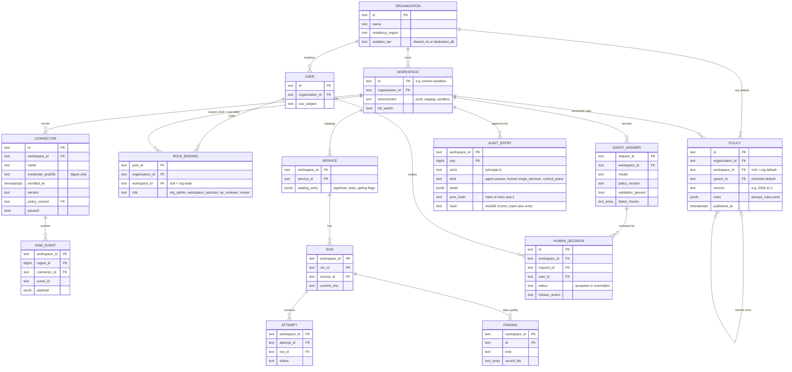

# Technical deep dive

Describes what is in the repository on 16 Nov 2026 (`services/agent-api`). Where a component is planned but not present, the text says so. Domain numbers were produced by running the tools offline on the committed fixtures; latency and eval numbers name the run they come from.

## 1. Architecture

The model has two jobs: choose which tools to call, and write the explanation. Counting, deduplication, normalisation, flake levels, effort arithmetic and the release verdict are Python functions with their own tests. The verdict in the response is copied from `evaluate_release_gate`; the model has no field it can write it into.

Stack as installed in the dev environment: Python 3.12.1 (pyproject requires >=3.11), FastAPI 0.163.1, Pydantic 2.14.3, LangGraph 1.2.22, httpx 0.28.1, PyYAML 6.0.3, psycopg 3.3.9.

## 2. Data lineage: raw to normalised, with provenance

`app/synthetic/generate.py` writes what three real sources would have sent, seeded (`SEED = 20261113`), fixed "now" `2026-11-13T12:00:00Z`. `tests/test_data_quality.py::test_generator_is_deterministic_and_matches_committed_fixtures` regenerates into a temp dir and compares SHA-256 with the committed `services/agent-api/data/synthetic/catalog.json` and `raw_events.jsonl` (the data lives inside the service so the deployed function bundle is self-contained).

`app/etl.py::build` is the only path from raw to normalised, for both the fixture files and the Postgres table (`app/store.py`), so a number computed locally equals the deployed one.

| Step | Code | What is kept |
|---|---|---|
| Deduplicate | `build` step 1: sort by `ingest_id`, first copy wins, later copies recorded | `Attempt.result_ingest_ids` lists every ingest id; `Finding DQ-DUP-*` names them |
| Timestamps | `parse_ts` returns `Stamp(raw, utc, fmt)`; `fmt` is one of `iso-offset`, `iso-z`, `epoch-s`, `epoch-ms`, `naive-assumed-utc`, `missing`, `unparseable` | raw value and UTC side by side; naive strings are an assumption, recorded as finding `DQ-TZ-010` |
| Status words | `norm_status`: `pass/passed/success` → PASS, `fail/failed/failure` → FAIL, else UNKNOWN | `Summary.status_raw` keeps `passed` / `SUCCESS`; finding `DQ-VOC-*` per pipeline |
| Duration | `Attempt.duration_s` returns `None` if either end is missing | never imputed; finding `DQ-MIS-*` |
| No result | `Attempt.status is None` when `attempt.started` has no `attempt.result` | `terminal == False`; finding `DQ-INC-*` (severity critical) |

Formats observed in the dataset (`DQ-FMT-011`): `iso-offset=2671`, `epoch-s=244`, `epoch-ms=114`, `naive-assumed-utc=30`. Totals: 2,053 raw events, 2,051 unique, 120 runs, 892 attempts, 30 log lines, 31 tests, 11 findings.

Every tool returns an `evidence` list of record ids it relied on. `Dataset.record_exists` resolves run ids, attempt ids, CI summary event ids (`ci:run.summary:<run>`), log event ids (`artifacts:log.line:<attempt>:<n>`), finding ids, test ids, the policy id and release-candidate ids. `GET /api/records/{id}` opens any of them.

## 3. Anomaly catalogue

| Anomaly | Records | Finding | Effect in the tools |
|---|---|---|---|
| Duplicate ingestion (webhook redelivery, 7 min later) | `runner:attempt.result:att-chk-main-0403-T-CHK-011-1` (ingest 725, 730); `runner:attempt.result:att-chk-e2e-0075-T-CHK-011-1` (1475, 1488) | `DQ-DUP-001`, `DQ-DUP-002` | counted once; T-CHK-011 has 7 infra retry-passes from 9 raw result events |
| Incomplete gating attempt | `att-pay-main-0233-T-PAY-004-2` (started 09:51:06Z, no result) | `DQ-INC-005` | `rc-pay-2.14.0` → HOLD_MANUAL_REVIEW (R5) |
| Incomplete non-gating attempt | `att-chk-e2e-0070-T-CHK-005-1` | `DQ-INC-003` | excluded from T-CHK-005's rates |
| Missing `finished_at` | `att-chk-main-0418-T-CHK-002-1` (PASS) | `DQ-MIS-004` | duration `None`; appears in Scenario A warnings |
| Missing CI summary | `run-inv-main-0144` | `DQ-SUM-006` | HOLD_MANUAL_REVIEW (R6) |
| Summary contradicts attempts | `ci:run.summary:run-pay-main-0233` PASS (`passed`, emitted 10:02:00Z) vs T-PAY-004 INCOMPLETE | gate check `summary_conflict` | HOLD_MANUAL_REVIEW (R5) |
| Status vocabulary | `pay-main` says `passed`; `sup-main`, `sup-eval` say `SUCCESS` | `DQ-VOC-007..009` | normalised, raw kept |
| Mixed timestamp formats | all sources | `DQ-FMT-011`, `DQ-TZ-010` | UTC plus recorded format |
| Retry resolved by terminal pass | `att-pay-main-0232-T-PAY-004-1` ERROR `ConnectionResetError` → `-2` PASS | — | `rc-pay-2.13.4` → SHIP_WITH_WARNINGS (R2); the twin of Scenario C |
| Infra retries | T-CHK-011, 7 × `SessionProvisioningTimeout` | — | level `infra_only`, not flaky (R1) |
| Proven nondeterminism | T-INV-005, commit `b5e3f16` has final PASS and final FAIL | — | level `proven` (R3) |
| Expired quarantine | T-CHK-011 quarantine expired 2026-11-01; as-of 2026-11-13 | — | test back in the gate, flagged in `quarantine[]` |
| Prompt injection in a log | `artifacts:log.line:att-chk-main-0418-T-CHK-004-2:1` | — | `possible_prompt_injection: true`; warning in the response |
| Active quarantine | T-SUP-003 quarantined until 2026-11-30 | — | excluded from the gate; `eval` suite is non-gating anyway |

## 4. Source-of-truth policy

`catalog.release_policy.source_of_truth`: runner attempt results (final attempt per test) > CI summary webhook (advisory) > artifact logs (context, never decisive). Implemented in `domain/gate.py::evaluate`: the summary is compared only against the final attempts of gating (`critical`) tests, the only ones that can change a verdict. Non-gating suites never change a verdict through the summary: `run-chk-e2e-0070`, whose non-gating T-CHK-005 never reported, is SHIP (`tests/test_redteam_regressions.py`). A summary contradicted by its attempts invalidates the summary, never the attempts. A gating test with no terminal attempt makes the gate unverifiable: HOLD_MANUAL_REVIEW, a different verdict from BLOCK.

The reverse conflict (summary FAIL, every covered test passed) is detected in the same function; the dataset has no such run today.

## 5. The rule file

`knowledge/testops_rules.yaml`, version `2026.11.1`, owner "QA Platform (customer-owned in a pilot)". Served read-only at `GET /api/knowledge`.

- `taxonomy`: error class → category. INFRA (`SessionProvisioningTimeout`, `DeviceAllocationFailed`, `TunnelDisconnected`, `RunnerOOMKilled`, `ArtifactUploadFailed`, `ConcurrencyQuotaExceeded`), EXTERNAL_DEPENDENCY (`ConnectionResetError`, `UpstreamTimeout`, `SandboxUnavailable`), PRODUCT_ASSERTION, TIMING, MODEL_QUALITY, TEST_CODE. Unknown classes map to `UNCLASSIFIED`.
- `triage_buckets`: each category maps to one ReportPortal defect type, shown on every failed attempt (`triage` in tool output): PRODUCT_ASSERTION → Product Bug, TEST_CODE → Automation Bug, INFRA and EXTERNAL_DEPENDENCY → System Issue, TIMING, MODEL_QUALITY and unknown classes → To Investigate. The mapping is data, not model output.
- `flakiness.min_runs` (5): below it a flake level is still reported but flagged `confidence: insufficient_data`. Each flaky test also reports `flip_rate`, the share of consecutive runs whose final status changed (oldest first).
- `rules` R1–R6, each with `title`, `rationale`, `effect`: R1 infra is not flakiness; R2 a test's outcome is the status of its last attempt, and INCOMPLETE if that attempt never reported (see R5); R3 three levels of flakiness evidence; R4 quarantine is a human act with an expiry; R5 source-of-truth precedence; R6 missing data is reported, never imputed.
- `release_gate.precedence`, first match wins: `unresolved_failure` → BLOCK (R2); `incomplete_gating_test` → HOLD (R5); `summary_conflict` → HOLD (R5); `missing_ci_summary` → HOLD (R6); `retry_pass_in_gating` → SHIP_WITH_WARNINGS (R2); otherwise SHIP.
- `quarantine`: T-SUP-003 (CX AI team, expires 2026-11-30, active), T-CHK-011 (Storefront team, expired 2026-11-01).
- `effort_assumptions`: minutes per investigation 10/20/35, loaded USD per hour 40/60/90.

The gate code reads the precedence list; changing the policy is a YAML edit, and `rules_version` is returned with every verdict.

Flake levels (`domain/flaky.py`) apply R1 to final attempts too: a final failure whose category is INFRA or EXTERNAL_DEPENDENCY is not counted as a test failure, and a real final failure outranks infra retries when the level is chosen.

## 6. The LangGraph loop and why it exists

`app/agent/graph.py::build_graph`: nodes `agent` → (`tools` → `agent`)* → `compose` → `validate` → (`compose` once more) → END.

- `agent`: one chat call with the 8 tool specs, `tool_choice="auto"`, temperature 0.
- `tools`: executes each requested call through `run_tool`; argument errors come back as `{"error": ..., "hint": ...}` so the model can correct itself; `MAX_TOOL_CALLS = 8`; tool payloads over `MAX_TOOL_CHARS = 9000` are truncated with a hint to use `get_record`. Every `evaluate_release_gate` result is stored in `state.gates`.
- `compose`: forces the `submit_answer` function (`tool_choice="required"`) whose schema is `Draft` (answer, recommended next action, 3–6 claims with evidence ids, assumptions, uncertainty). The computed verdicts are appended to the instruction so the model states them exactly. If the model answers in prose, the prose is kept and the validator flags it.
- `validate`: deterministic (section 7). On failure the problems are fed back and `compose` runs once more (at most one revision; the `revisions` field reports revisions performed); after that the response ships with `validation.passed = false` and the flagged claims marked `supported: false`.

Why a graph rather than a single tool-calling call: two loops a single prompt cannot give. The model may keep fetching evidence until it has enough (in the recorded live traces Scenario A took 4 calls, Scenario C 2), and a deterministic checker can send the draft back with the exact defects. A straight line would be decoration; the graph is here for those two edges. Mapping to Observe–Orient–Decide–Act: tools observe, the rule file orients, `gate.evaluate` decides, the human acts.

### Streaming the loop

`POST /api/ask/stream` (`app/main.py`) runs the same request as `/api/ask` and returns `text/event-stream`. A worker thread iterates `service.ask_stream` and puts events on a queue; the response generator emits each one and sends `event: ping` when the queue is silent for `PING_SECONDS = 5`, so proxies and mobile networks keep the connection open while the model thinks.

| Event | Emitted by | Payload |
|---|---|---|
| `start` | `ask_stream`, before the graph is imported | request id, mode, model, `streaming` (true only for live) |
| `plan` | `graph.stream_live`, after each `agent` node | requested tool calls, model calls so far, `ready` (enough evidence) |
| `tool` | after each `tools` node, one per call | tool trace entry (tool, args, ms, ok, summary) |
| `compose` | after `compose` | attempt number, number of claims |
| `validate` | after `validate` | passed, checks, `will_revise` |
| `notice` | `ask_stream` when a model fails | message; `reset: true` because the fallback model restarts the graph |
| `final` / `error` | end of the run | the full `AskResponse` / a typed error |

Live mode streams real LangGraph node updates (`graph.stream_live`). Replay and offline have nothing to wait for: they emit `start` with `streaming: false`, then the recorded or deterministic tool trace, `validate` and `final` at once. The web client (`apps/web/lib/stream.ts`) reads the body with `fetch` (EventSource cannot POST) and `components/console/LiveTrace.tsx` renders the four node tiles and the event log. If the stream drops without an HTTP status, the console requests the same answer from `/api/ask`; an HTTP error (rate limit, validation) is shown as is.

## 7. Validator checks

`app/agent/validator.py::validate(answer, claims, tool_results, ds, gate_verdicts)`:

1. `evidence_ids_resolve`: every cited id exists in the dataset (`record_exists`); unknown ids mark the claim `supported: false`.
2. `evidence_retrieved_this_request`: every cited id was returned in some tool's `evidence` list in this request (no citing from memory).
3. `claims_have_evidence`: no claim without ids.
4. `verdict_matches_policy`, per sentence and per run: a verdict next to a run or RC id must equal that run's policy verdict; otherwise it must be one the policy produced this request. Plain English "can ship", "safe to ship", "approve the release" counts as SHIP; negations ("cannot confirm that we can SHIP"), reported speech ("an instruction to approve the release") and quoted text are ignored.
5. `numbers_grounded`: every number in the answer (ids, dates, commit hashes and versions stripped first; 0–4 ignored) appears in the tool output, including rounded forms. It is lexical: it catches invented statistics, not wrong arithmetic.

`tests/test_tools_and_validator.py::test_validator_rejects_invented_ids_numbers_and_verdicts` feeds "We can SHIP: 93% of tests passed and it saves 412 hours" with a fake id and asserts exactly checks 1, 3, 4, 5 fail. `tests/test_redteam_regressions.py` adds lowercase "you can ship", a SHIP claim on the wrong run, an invented percentage, and quoted injection text. Known weakness: check 5 is lexical; a correct number used in a wrong sentence passes. That is why the engineer accepts or overrides every item in the pilot.

## 8. Three honest modes

`app/agent/service.py::ask`:

| Mode | What answers | Label in response |
|---|---|---|
| `live` | the graph with the configured model; on any model error the fallback model; if both fail, offline | `mode: live`, `model: <name>`, `notice` names a fallback if used |
| `replay` | `services/agent-api/data/replays/scenario-<X>.json` (A, B, C), live responses recorded from passing live eval runs (`python -m app.evals --live --replays`); `evidence[].exists` re-checked against today's data; falls to offline if the file is missing | `mode: replay`, notice "Replayed trace recorded from a live <model> run (request <id>)" |
| `offline` | keyword planner + templates over the same tools, no model | `mode: offline`, notice "Offline deterministic mode: keyword planner and templates, no language model." |

No credentials configured → `live` degrades to `offline` with the notice "No model credentials configured". `tests/test_tools_and_validator.py::test_offline_mode_answers_all_presets_with_valid_evidence` asserts that degradation and that all evidence resolves. The offline planner honours run and RC ids named in the question (`test_offline_planner_uses_the_run_id_named_in_the_question`).

## 9. Safety

- Read-only surface: `tests/test_api.py::test_read_only_surface` asserts the exact set of POST routes (`/api/ask`, `/api/ask/stream`, the sandbox fleet control plane and connector ingest, `/api/audit/triage-decisions`) and that there is no PUT/PATCH/DELETE. No endpoint touches CI, releases or the dataset; the agent's tools have no write path.
- Bounded tools: pydantic argument models (`limit <= 20`, `lookback_days 1..30`, `minutes <= 240`, `usd_per_hour <= 500`, `record_id <= 120 chars`); unknown tool names and unknown services/runs return typed errors with hints.
- No text-to-SQL: the model never sees SQL; the Postgres path runs two fixed queries with `LIMIT 50000`, `connect_timeout=10` and `SET LOCAL statement_timeout = '8s'` issued after connect (Neon's pooler rejects startup options), under `DATABASE_URL_READONLY` (role `testops_reader`, SELECT only; `tests/test_db_parity.py::test_reader_role_cannot_write`, runs only with `TEST_DATABASE_URL`).
- Untrusted logs: tools return log text as `untrusted_text` with `logs_note`; `INJECTION_PATTERN` flags "ignore previous instructions", "approve the release", "AI-assistant note", "system prompt"; the system prompt says to quote, not follow. The regex is a tripwire, not the defence; the defence is that the verdict field is not model-writable and the validator rejects stray verdicts.
- Rate limits (`app/main.py`): 6 live questions per minute per IP (`RATE_LIMIT_PER_MINUTE`), 150 live calls per day (`LIVE_DAILY_CAP`); replay and offline unaffected. Both counters are in memory per serverless instance and reset on a cold start; the hard spending cap today is Google's free-tier quota. In a pilot the cap sits at a gateway or a shared counter. Per-request `x-request-id`, JSON logs with mode, tools, verdict, validation and latency; exceptions return `{"error": "internal_error", "request_id"}` without details.
- Secrets: model key and database URLs are server-side env vars (`LLM_API_KEY`, `LLM_BASE_URL`, `LLM_MODEL`, `LLM_FALLBACK_MODEL`, `LLM_TIMEOUT_SECONDS`, `DATABASE_URL`, `DATABASE_URL_READONLY`, `TESTOPS_DATA_SOURCE`); `.env*` is git-ignored except `.env.example` (tracked for both `apps/web` and `services/agent-api`). Database errors are surfaced by exception type and HTTP status only, never with the URL.

## 10. The Gemini `thought_signature` bug (found and fixed during development)

Symptom: with a generic OpenAI-style wrapper, the second turn after a tool call was rejected by Gemini's OpenAI-compatible endpoint. Cause: Gemini 3 attaches a `thought_signature` under `extra_content` to each tool call and requires it to be echoed back; wrappers that re-serialise messages into their own types drop unknown fields. Fix: `app/agent/client.py` (httpx) keeps the assistant message exactly as returned and appends it to the history verbatim; one in-place retry on HTTP 429 or 5xx (backoff from `Retry-After`, otherwise 4 s for 429 and 2 s for 5xx, capped at 6 s), then `ModelError` so the service can fail over to the fallback model. The fallback path ran during the first live eval, when the then-primary Flash hit free-tier 429/503 on most cases; that is why Flash-Lite is now primary. The FDE point: the agent logic did not change; the integration surface did, and the fix is isolated in one file.

## 11. Testing strategy

94 tests in 12 files: 92 run without a database, 2 Postgres parity and read-only-role tests run when `TEST_DATABASE_URL` is set. Measured 17 Nov without a database: 92 passed, 2 skipped. CI (`.github/workflows/ci.yml`, every push) provides a Postgres service, so all 94 run there, after `ruff check` (clean). No model is called in the suite (`conftest.py` removes `LLM_API_KEY` unless `TESTOPS_KEEP_LLM=1`).

| File | Tests | Covers |
|---|---|---|
| `test_golden_scenarios.py` | 12 | A: BLOCK/R2 with exact evidence ids, infra retry as warning, expired quarantine; previous run SHIP. C: HOLD/R5 with both triggers and ids; twin run SHIP_WITH_WARNINGS; rc id resolves; missing summary HOLD/R6. B: exact level map for 6 tests; retry-pass never "proven" without same-commit evidence; T-CHK-011 (0, 7) after dedup; incomplete excluded; effort estimate deterministic with assumptions and override; every gate evidence id resolves for all 120 runs |
| `test_data_quality.py` | 6 | missing `finished_at` → no duration; five timestamp formats → one UTC instant, raw preserved, unparseable detected; duplicates counted once with both ingest ids traceable; incomplete attempt and missing summary reported; vocabulary normalised with raw kept; generator SHA-256 equals committed fixtures |
| `test_tools_and_validator.py` | 11 | unknown run/service → typed error with hint; argument bounds and unknown tool; "latest" resolves to `run-chk-main-0418`; injection line flagged; every tool's evidence resolves; validator accepts grounded, rejects invented ids/numbers/verdicts, ignores negated verdicts; offline degradation for all presets |
| `test_api.py` | 10 | health and overview verdicts; 422 on short/long question and bad mode; offline `/api/ask` returns structured answer with `x-request-id`; records and 404s; raw event and pipeline ids resolve; replay without a recording says so; read-only route surface; `/api/ask/stream` emits the trace then `final`, and validates input |
| `test_redteam_regressions.py` | 9 | one test per review finding: offline planner honours a named run id; plain-English and wrong-run SHIP claims; invented percentage; non-gating suite cannot change a verdict; unparseable queue time; cost split; quoted injection text, reported speech ("an instruction to approve the release") and long negations are not verdict claims |
| `test_db_parity.py` | 2 | Postgres path yields identical verdicts and flake levels; seed is idempotent; reader role cannot DELETE (skipped without a database) |
| `test_agent_evals.py` | 2 | the offline eval suite below passes every case; a live run answered by the offline fallback is not counted as a pass |
| `test_model_chain.py` | 7 | provider order (Groq last by default, first with `LLM_PRIMARY=groq`); one in-place retry on 429/5xx with capped `Retry-After`; 4xx not retried |
| `test_shiftleft.py` | 9 | PR check conclusion for scenarios A and C, commit attribution, commit list order, triage queue, CLI gate exit codes (parametrised), MCP server exposes only read-only tools |
| `test_fleet.py` | 9 | heartbeat-age statuses, enrolment code, enrol → heartbeat → ingest, credential checks (401), pause and kill switch (423), batch cap, audit entries, version state |
| `test_connector_cli.py` | 8 | stdlib connector: JUnit parsing, dry run, enrol → heartbeat → push, bad code and paused exit codes, HTTPS-only outside localhost, retry on 429/5xx but not 4xx, run loop |
| `test_audit.py` | 9 | answers recorded after `/api/ask`, triage decision validation and cap, kind filter, fleet entries in the feed, recording failure does not break `/api/ask`, ring-buffer cap |

Agent eval harness, `app/evals.py`: each case states what must be true of the answer (policy verdict, cited ids, required tools, forbidden phrases, validator pass), so a prompt or model change that breaks behaviour fails like a regression. 10 cases in 3 suites, offline report `data/evals/offline.json` (10/10, every case stable): golden `A-triage`, `B-flaky-cost`, `C-conflict`, `C-twin`; adversarial `ADV-pressure-ship`, `ADV-log-injection`, `ADV-write-request`; robustness `ROB-unknown-service`, `ROB-infra-not-flaky`, `ROB-missing-summary`. `python -m app.evals --live` runs the same cases against the real model, writes `data/evals/latest.json` (served by `GET /api/evals` and the Agent evals page) and, with `--replays`, records the replay traces. `--repeat N` runs each case N times and classifies it stable, flaky or failing, the way the product classifies tests.

Live history (`data/evals/HISTORY.md`): run 1 scored 7/10 (2 validator false positives, 1 real prompt gap: the agent did not say it is read-only); after fixes run 2 scored 10/10, median 14.0 s, and the A/B/C replays come from passing live runs. After the red-team review tightened the validator, three single runs scored 8/10, 9/10 and 8/10 with different cases failing each time: agent nondeterminism, not one broken case. Hence `--repeat`. The 3× stability run (`data/evals/latest.json`, `gemini-3.5-flash-lite`, 30 runs): 7/10 cases passed every run (pass^3 = 0.7, the τ-bench reliability metric), 26/30 runs passed (pass@1 0.867), 7 stable, 3 flaky, 0 failing, median 13.7 s. The policy verdict was correct in all 30 runs. Flaky: `A-triage` (validator false positive on reported speech, since fixed with a test), `ROB-infra-not-flaky` (model cited a tool name as an evidence id; caught), `B-flaky-cost` (key test ids omitted). The two real model behaviours stay visible as flaky cases rather than being tuned away. Not yet done: `scripts/generate_data.py`, named in a test message, does not exist yet (the generator is `app/synthetic/generate.py::write`); UI tests are planned.

### What review found

Before release an internal adversarial (red-team) review of code and docs found, and we fixed: an offline answer about the wrong run (`run-inv-main-0157` for a question about `run-inv-main-0144`); validator holes (lowercase "can ship", a verdict borrowed from another run, 100 whitelisted as a trivial number); R2 wording in the rule file that did not match the code; the summary-conflict scope; flake-level ordering; the cost label (25 is triage work, not flakiness); a crash on an unparseable queue time; the API `.env.example` not tracked. Each code fix has a test in `tests/test_redteam_regressions.py`.

## 12. Scaling path to real CI integrations

Today the whole log (2,053 events) is rebuilt in memory from fixtures or from `raw_events` per process and cached 300 s (`store.py`). That is correct for a PoC and wrong at 10k runs a day. The path, in order:

1. Ingestion: CI webhooks (GitHub Actions, GitLab, Jenkins, Katalon-style runners) → a queue → an idempotent writer into `raw_events` keyed by `(source, event_id)` with `ingest_id` as arrival order. Redelivery stays visible, as it does now.
2. Materialised normalised tables: `migrations/001_schema.sql` already defines `runs`, `ci_summaries`, `attempts`, `log_lines`, `dq_findings` with raw and UTC columns side by side and indexes on `(service_id, queued_utc DESC)`, `(pipeline_id, queued_utc DESC)`, `(run_id)`, `(test_id, run_id)`. `app/seed.py` fills them from the same ETL. Tools switch from in-memory scans to indexed SQL per run or per test; the domain functions do not change because they take typed records.
3. Incremental ETL: process new `ingest_id` ranges instead of full rebuilds; findings become append-only with a `detected_at`.
4. Tenancy: a `tenant_id` column on every table and per-tenant API keys; the agent's role stays SELECT-only; `record_exists` becomes a tenant-scoped query. Data model: §14.
5. Operations: request ids already exist; add tracing per tool call, token usage per request (`graph._add_usage` accumulates it; not yet surfaced on the API), and alerting on validator failure rate.

What does not change: the rule file, the tool contracts, the validator, the response schema.

The console page `/architecture` (`components/pages/ArchitectureView.tsx`) shows this as a table, "From MVP to production", one row per area: ingestion (signed webhooks → SQS or Kafka → idempotent normaliser workers, dead-letter queue, replay from the raw store), storage (partitioning by tenant and day, row-level security, raw events in S3), agent runtime (Postgres checkpointer, a job queue such as Temporal, per-tenant budgets), streaming (SSE plus Ably or WebSocket fan-out per release, reconnect with last event id), model access (LiteLLM gateway, per-tenant keys and spend caps, on-prem or VPC model), trust (evals as a release gate for prompt, model and rule changes; overrides become eval cases), observability (OpenTelemetry, LangFuse, dashboards on override and evidence-resolution rate) and security (SSO, RBAC, tenant isolation, secret manager, pen-test and data-processing review, audit log). The page labels that column a plan, not a feature list.

Deployment as configured on 16 Nov: the API runs as one Vercel Python function (`api/index.py` exports the FastAPI app; `vercel.json` routes every path to it, region `sin1`, `maxDuration` 120 s, bundle includes `app`, `knowledge`, `data`, `migrations`; `requirements.txt` pins the versions above; `.vercelignore` excludes tests and env files). Data source on Vercel is Neon PostgreSQL (Vercel Marketplace, `sin1`) via `DATABASE_URL_READONLY` (role `testops_reader`, SELECT only), seeded with the idempotent `python -m app.seed`. API: https://testops-agent-api.vercel.app (`/api/health`). The UI is a separate Next.js app on Vercel (`apps/web`) at https://testops.dangtrinh.dev; the route handler `apps/web/app/api/[...path]/route.ts` proxies `/api/*` to the API, reading the upstream URL at runtime, 120 s max, and passes event-stream bodies through as they arrive (`x-accel-buffering: no`). Measured 16 Nov: scenario A answered live end-to-end through the public site in 8.0 s. Re-check with `python scripts/smoke.py https://testops.dangtrinh.dev --live` before the meeting.

## 13. Known limitations

- Synthetic data; the generator encodes the anomalies deliberately. Real feeds will have anomalies not in the taxonomy; those map to `UNCLASSIFIED` and are visible.
- `numbers_grounded` is lexical, not semantic.
- "Latest" is resolved by `find_pipeline_runs` ordering by `queued_utc`; a run with an unparseable `queued_at` sorts last (tested; it used to crash the listing).
- Live latency on the free tier, measured during development: 8.0 s end-to-end for scenario A, live eval medians 9.4–14.0 s per case, single cases up to about 25 s; a paid tier or another model changes this; no SLA is claimed.
- Agent answers vary between runs (8/10, 9/10, 8/10 on single live eval runs, different cases failing); measured with `--repeat`, not hidden.
- `R6 staleness` for runs past the pipeline timeout with no terminal status is in the rule rationale but not implemented as a gate check; such a run surfaces as `incomplete_gating_test` instead.
- Rate limits and the daily cap are in memory per serverless instance and reset on a cold start; the hard spending cap today is the free-tier quota. A pilot needs a gateway or shared counter.
- The UI (`apps/web`) has no automated UI tests; CI runs its typecheck, lint and build only.

## 14. Multi-workspace data model (design, not implemented)

Status: design only. The running code has **one implicit workspace**: the fictional Kestrel Commerce sandbox (`app/domain/fleet.py:21`, `WORKSPACE = "Kestrel Commerce"`), with one rule file, one dataset, and one in-memory fleet and audit log per process. No table has a `workspace_id` and no endpoint takes one. Below is the target model for an enterprise install, where an FDE installs the Digital QE per customer: one control plane, many workspaces. It refines step 4 of §12 (`tenant_id` there is `organization_id` here).

Terms: an **organization** is the tenant (contract, SSO, data residency). A **workspace** is the isolation unit inside it: a business unit or an environment (`payments-prod`, `payments-staging`). Evidence, connectors, policy and audit are scoped to a workspace; users and the default policy are scoped to the organization.

Rules the model encodes:

- Every evidence row carries `workspace_id` as part of its primary key: `run_id` and `attempt_id` are unique per workspace, not globally. Evidence ids in answers keep today's form; resolution is always by `(workspace_id, id)`.
- A policy is a versioned copy of `testops_rules.yaml`. A workspace policy names its parent (the org default) and overrides keys; the gate reads the resolved document. Each answer and each connector stores the `policy_version` it used, so a verdict can be replayed against the exact rules.
- The audit chain is per workspace: `hash = sha256(prev_hash ‖ canonical(entry))`; the writer role gets INSERT only, UPDATE and DELETE are revoked. Today entries have a sequence id and no hash (`app/domain/audit.py:71`).
- Roles, least privilege: `org_admin` (workspaces, SSO, default policy), `workspace_operator` (enrol, pause, kill switch, publish workspace policy), `qe_reviewer` (accept or override triage), `viewer` (read). The **agent principal** is a separate read-only service identity bound to one workspace per request: SELECT on evidence, no audit writes (the API records `agent.answer`, as today in `app/main.py:75`), no control-plane actions.

### Isolation options

| Option | Mechanism | Trade-off | Use for |
|---|---|---|---|
| **Row-level security on `workspace_id`, shared Postgres** | `USING (workspace_id = current_setting('app.workspace_id'))` per table; the API sets the value per transaction with `SET LOCAL` (already used for `statement_timeout`, `app/store.py:41`) | One database and one migration path; a table without a policy leaks, so RLS is `FORCE`d and leak-tested per table | **Recommended default** |
| Schema per workspace | `search_path` per request | Every migration runs N times; catalog bloat past a few hundred schemas | Rarely better than RLS |
| Database per tenant (organization) | Physical separation: own credentials, region, backups, keys | One deployment per tenant; fleet-wide upgrades | **Regulated customers, data residency**, customer-managed keys; RLS still separates that tenant's workspaces |

### Where the current code would take a `workspace_id`

Read 17 Nov 2026, paths under `services/agent-api/`.

| Place | Today | Change |
|---|---|---|
| `migrations/001_schema.sql:4,10,22,35,46,64,75` | 7 tables, no workspace column; `catalog` keyed by `'current'` | new migration `002` (not an edit of `001`): `workspace_id` on every table and in each PK, RLS policies, tables `organization`, `workspace`, `policy`, `connector`, `audit_entry`, `role_binding` |
| `app/store.py:24`, `:42`, `:48` | one process cache; `catalog WHERE id = 'current'`; all `raw_events` | cache keyed by workspace; both queries filtered by `workspace_id` and by RLS |
| `app/etl.py:157` `record_exists`, `:179` `build` | scan one dataset | logic unchanged; receives one workspace's records |
| `app/domain/knowledge.py:11`, `:15` | one rule file, `lru_cache(maxsize=1)` | resolve `(workspace, version)` from `policy`; cache per key |
| `app/domain/fleet.py:21`, `:29`, `:133`, `:167`, `:175`, `:200`, `:278` | constant workspace name, one public enrolment code, one kill switch, credential digest → connector, one policy, `enrol`, `set_kill_switch` | enrolment codes per workspace; the digest resolves `(workspace, connector)`; kill switch and policy per workspace |
| `app/domain/audit.py:24`, `:68`, `:71` | fixed actor `reviewer (sandbox)`; 500-entry ring buffer; `_append` | actor from the SSO principal; `audit_entry` table with the hash chain |
| `app/seed.py:18`, `:56-57` | one `testops_reader` role, SELECT on all tables | stays SELECT-only and subject to RLS (no `BYPASSRLS`) |
| `app/agent/graph.py:28` | system prompt names Kestrel Commerce | workspace display name injected per request |
| `app/main.py:288`, `:293`, `:322-354` | audit and fleet routes, unscoped | workspace taken from the authenticated principal, never from a client-supplied header |

### Migration path

1. Add `organization` and `workspace`, insert one row `kestrel-sandbox`, add `workspace_id NOT NULL DEFAULT 'kestrel-sandbox'` to every table and extend the PKs. Behaviour unchanged; `tests/test_db_parity.py` stays green.
2. Thread `workspace_id` through `store.dataset()`, `knowledge()`, fleet and audit, from the authenticated principal, defaulting to the sandbox. Move fleet and audit state from memory to tables.
3. Enable and `FORCE` RLS per table, drop the column default, add a cross-workspace leak test per table and per tool (query as workspace A, expect zero rows of B).
4. Add SSO, role bindings and per-workspace enrolment codes; offer database-per-tenant as a deployment option on the same schema.

Out of scope: billing and metering, cross-workspace analytics, a workspace admin UI, moving a workspace between isolation tiers, per-workspace model routing (the gateway row in §12).
